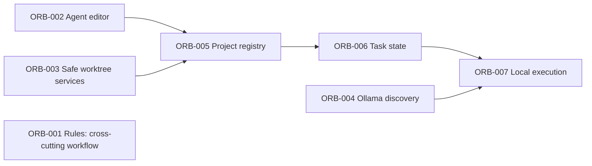

# Tracked implementation backlog

[Requirements](docs/requirements.md) define product acceptance; the [roadmap](docs/roadmap.md) defines phase exit gates. Stable ORB IDs are never reused. Work-item files under `docs/work-items/` are canonical live scope/evidence; links below identify their agreed locations and may be pending until the owning PR adds them. This index does not establish runtime completion.

Status: **approved** = authorized bounded scope; **in progress** = work launched, not accepted; **planned** = not launched. Completion requires a real PR, validation evidence and verified review/merge state. No runtime completion is asserted here.

| ID | Scope / canonical evidence | Status | Dependencies | Requirements | Acceptance gate |
| --- | --- | --- | --- | --- | --- |
| ORB-001 | [Rules and backlog](docs/work-items/ORB-001.md), this PR chat | In progress | None | R02, R05–R12 | Five-file documentation scope; truthful index, isolated PR workflow and independent review/explicit merge rule validated. |
| ORB-002 | [Agent CRUD editor](docs/work-items/ORB-002.md), separate PR chat; owns existing app/store/frontend | In progress (launched; evidence pending owning PR) | None | R01, R03, R04 | Create/edit persisted agent fields through existing API; validation, errors and identity persistence checked; UI build passes. |
| ORB-003 | [Standalone safe project/worktree services](docs/work-items/ORB-003.md), [PR #3](https://github.com/roshan-davis/orbit/pull/3); no API/schema changes | Complete (validated; independent review approved) | None | R02, R08 | Temporary-repo tests verify canonical roots, isolation, traversal/symlink boundaries and preservation of user changes; no destructive cleanup. |
| ORB-004 | [Local-only Ollama discovery](docs/work-items/ORB-004.md), separate PR chat; providers.py plus new modules/tests | In progress (launched; evidence pending owning PR) | None | R06, R07 | Installed-model discovery and unavailable/error states tested; bounded loopback discovery, no pull or cloud calls; capabilities remain honest. |
| ORB-005 | [Project registry persistence/API](docs/work-items/ORB-005.md), evidence file pending | Planned | ORB-003, ORB-002 | R01, R02, R08 | Transactional migration and persistence/API tests; validated roots use safe services; restart preserves registrations; no main mutation. |
| ORB-006 | [Task/assignment schema and state machine](docs/work-items/ORB-006.md), evidence file pending | Planned | ORB-005 | R03–R05, R08 | Assignment snapshots, atomic legal transitions, dependency gates and audit events tested; invalid transitions rejected. |
| ORB-007 | [Local execution, logs and cancellation](docs/work-items/ORB-007.md), evidence file pending | Planned | ORB-004, ORB-006 | R05, R07, R08, R15 | Temporary-repo local task produces reviewable diff; bounded logs, cancellation and failure/restart behavior tested without duplicate execution or main mutation. |

ORB-001 does not block the already authorized ORB-002–004 work. ORB-005–007 remain planned; this index does not launch them. Phase 1 remains gated on the full safe local mission, not isolated feature PRs. Later subscription CLI support, orchestration, energy, skills, distribution, private remote access and design integrations remain [roadmap phases 2–8](docs/roadmap.md); no new implementation chats are authorized by this index.
