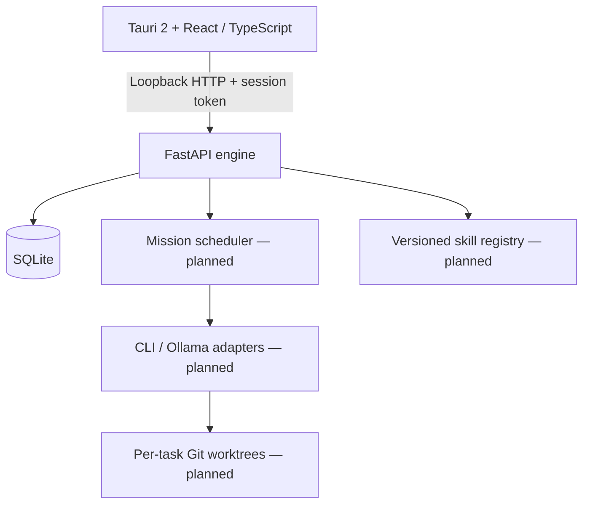

# Architecture

## Boundaries

The frontend renders state and approval requests. Rust supplies the desktop shell; later it supervises a packaged Python sidecar, passes an ephemeral secret through a narrow IPC boundary, verifies health, and stops its owned child on exit. The foundation uses a manually started engine and token entry. No shell plugin or generic command execution is exposed to the webview.

FastAPI binds to loopback only. All data endpoints require a bearer token; health exposes only service status. Exact development/Tauri origins are allowed, not wildcard CORS. The engine refuses to start without a private token. Loopback and CORS alone are not authentication. Packaged networking and sidecar lifecycle need end-to-end verification before release.

## Domain model
Keep Agent, Role, Skill, Provider/Model and Task independent. Agent identity is persistent; a task assignment snapshots instructions, skill versions, provider binding, permissions and worktree so later edits do not mutate a running task. Mission teams are temporary. Shared project knowledge and agent memory have separate scope and retention.

Planned tables: projects, agents, role definitions, missions, tasks, assignments, runs, review decisions, approval requests, artifacts, events, provider accounts, quota pools/windows/observations, skill versions/evaluations/publications. Foundation schema contains only agent profiles and schema metadata. A single migration version is established; later migrations must be explicit and transactional. Enable foreign keys and WAL; short transactions and one logical write coordinator avoid concurrency contention. Back up consistently and test restore before destructive migrations.

## Lifecycle and recovery (planned)
Task states: queued → ready → assigned → running → awaiting_review → awaiting_approval → completed; also blocked, failed and cancelled. Dependency completion gates ready. Review rejection creates a revision assignment. Persist transitions and an append-only event record in the same transaction. Claim tasks atomically with leases, idempotency keys and bounded concurrency. On restart, reconcile subprocess ownership and worktrees before reclaiming expired runs; never blindly repeat external actions. Stream sequenced events using SSE initially, with reconnect/replay cursors.

## Provider boundary (planned)
Adapters expose discovery, auth readiness, capability negotiation, start, streamed events, cancel and optional usage observation. Events normalize text, tool activity, artifact, completion, rate limit, auth failure, unsupported and error. Use argument arrays, explicit cwd, timeouts, bounded output and process-group cancellation. Credentials stay with the official CLI; never read its token store. Child environments exclude API keys and explicit API/Vertex modes, but that exclusion alone does not prove subscription use: verified provider-specific auth checks are required. Unsupported routes remain blocked.

## Worktree boundary (planned)
Register a canonical project root after checking Git ownership and status. Create a unique task branch/worktree outside the main checkout; record base SHA, branch and path. Check path containment and symlinks. Tool permissions are enforced independently of prompts. Show diff, tests and peer review before a human-authorized merge. Conflicts block integration; never reset user files or force-remove dirty worktrees. A worktree separates changes but is not a process security sandbox.

## Skills and approvals (planned)
Immutable content-addressed skill versions record source evidence, declared permissions, compatibility and evaluation results. Publication requires tester evidence, independent review and human approval tied to the exact version digest. Expire approval on content changes. Rollback changes the active pointer to a previously approved version, with an audit event; already running assignments retain their pinned version. High-risk tool grants and merges follow equivalent approval boundaries.

## Energy model (planned)
Pool identity includes provider + account + shared allowance, not agent ID. Each pool has multiple rolling/calendar windows and observations containing value or null, source, observed_at, reset_at, confidence and expiry. Stale observations become unknown. Do not add weekly and short-term allowances: the most restrictive active window constrains scheduling. Provider resets may be estimates and do not guarantee replenishment until observed. Agent bars link back to shared pools. Pool aggregation needs comparable units and defensible weights; omit an overall percentage otherwise. Local compute reports model availability, memory pressure, active load and queue depth separately. Preserve interactive-use reserves.

## Later remote/design integrations
Place a private authenticated gateway in front of engine commands; do not change bind address casually. Pair and revoke devices, encrypt transport, audit remote approvals and restrict privileges. No particular VPN or hosting vendor selected. Stitch and Claude design connectors import/export artifacts through capability-gated interfaces; availability and subscription terms remain discovery work.
