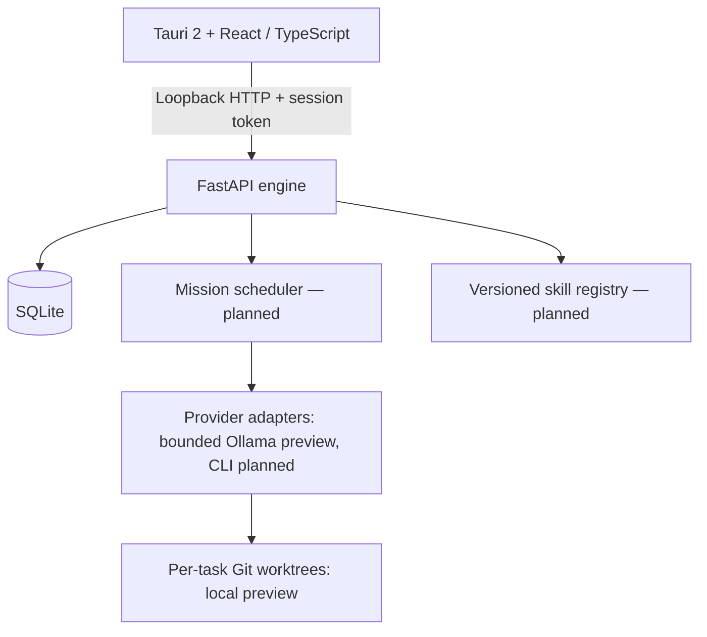
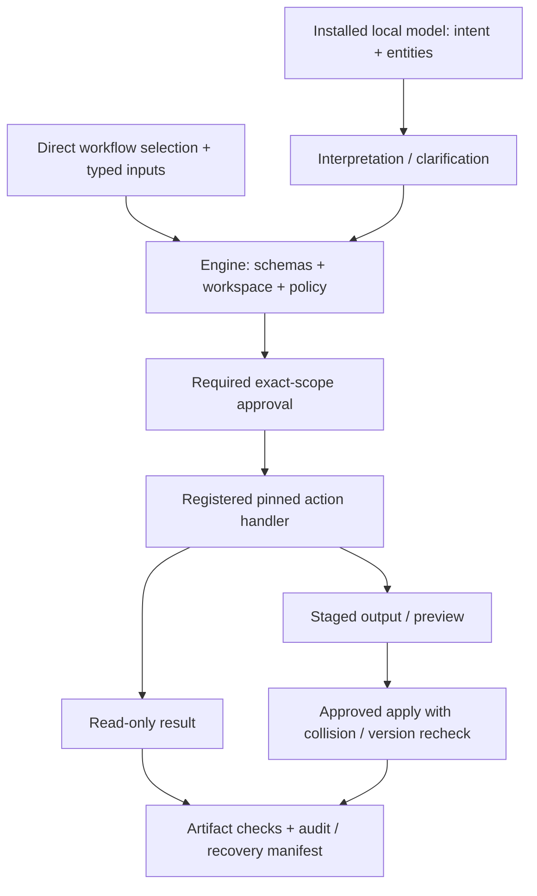

# Architecture

## Boundaries

The frontend renders state and approval requests. Rust supplies the desktop shell; later it supervises a packaged Python sidecar, passes an ephemeral secret through a narrow IPC boundary, verifies health, and stops its owned child on exit. The foundation uses a manually started engine and token entry. No shell plugin or generic command execution is exposed to the webview.

FastAPI binds to loopback only. All data endpoints require a bearer token; health exposes only service status. Exact development/Tauri origins are allowed, not wildcard CORS. The engine refuses to start without a private token. Loopback and CORS alone are not authentication. Packaged networking and sidecar lifecycle need end-to-end verification before release.

## Domain model
Target domain: Project owns goal, instructions, configured team, missions/tasks,
decisions/history and acceptance. Workspace defines registered roots, kind, scope
and change isolation. Start with one primary workspace per project; do not build
an unnecessary hierarchy. Atelier development is one project with a Git workspace;
photo processing is a different project with a folder workspace. Context, files,
history and grants stay separate. Persistent agent identities may participate in
both through assignment-scoped context/access, never implicit cross-project sharing.
Existing project/root records are not proof that this richer split is implemented;
introduce it through explicit transactional migrations preserving current identity.

Keep Agent, Role, Skill, Provider/Model and Task independent. Agent identity is persistent; a task assignment snapshots instructions, skill versions, provider binding, permissions and worktree so later edits do not mutate a running task. Mission teams are temporary. Shared project knowledge and portable agent memory have separate scope and retention; portable history must not carry one project’s private content into another assignment without an explicit grant.

Target persistence includes projects/workspaces, agents, role definitions, missions, tasks, assignments, runs/steps, reviews/approvals, artifacts/events, action/workflow versions, provider accounts, quota pools/windows/observations and skill versions/evaluations/publications. The preview has schema v4: v3 project/task/dependency/assignment/event state plus ORB-007 run records. This is not implementation of the full target model. Migrations are explicit and transactional; see ORB-005 and ORB-006 canonical evidence for implemented contracts and limits. Enable foreign keys and WAL; short transactions and one logical write coordinator avoid concurrency contention. Back up consistently and test restore before destructive migrations.

## Model selection and assignment binding (planned)

Agent configuration has a default provider/model plus explicitly allowed bindings
and a selection policy. Bindings distinguish family, exposed model ID/version and
capability tier; role/seniority remain identity/authority fields. Select for task
complexity/risk, expertise, evaluated capabilities/context/features, availability,
subscription auth/quota or local compute, permissions and user cost preferences.
Older/smaller models may be suitable; latest/largest is not a ranking rule. Reject
unsupported settings and insufficient capabilities rather than inferring tools from
a model name. Independent review needs a distinct reviewer agent, not necessarily
a different model family or the newest model.

A new assignment snapshots provider, exact exposed model identifier/version,
supported settings, selection reason, policy/version and capability/readiness evidence.
Pin revision/digest when available; mutable aliases retain an explicit reproducibility
limit. Default/profile edits affect future assignments only. Engine preflight checks
readiness against the recorded binding; do not silently substitute on failure.
Policy-authorized choices among named alternatives apply to new assignments within
the existing scope/cost/grant, with visible audit evidence. An unavailable eligible
model blocks actionably; provider/cost/permission expansion requires approval.
No API fallback, automatic downloads or quota/auth bypass. The current profile and
assignment snapshot hold the single saved provider/model; this richer selector and
metadata are planned migration/UI work, not delivered by this documentation PR.

## Lifecycle and recovery
ORB-006 implements task metadata transitions, assignment snapshots, dependency gates and transactional history. ORB-007 adds bounded local execution, saved logs/diffs and cancellation endpoints; ORB-008/009 expose manual review/completion and Help. Reviewer/human identity fields are assertions by the trusted session holder, not actual separate reviewer execution or worker authorization. Run records bind the worktree/base; assignment snapshots do not verify skill versions. See canonical ORB-007–009 evidence for exact preview limits.

Task states: queued → ready → assigned → running → awaiting_review → awaiting_approval → completed; also blocked, failed and cancelled. Dependency completion gates ready. Current review rejection returns the task to ready and requires reassignment; the planned coordinator owns that follow-through within scope. Persist transitions and an append-only event record in the same transaction. ORB-007 atomically claims one run per assignment with one worker per database and marks interrupted runs failed/cancelled without retry. Broader coordinator leases, per-effect idempotency and bounded multi-agent concurrency remain planned. On restart, reconcile subprocess ownership and worktrees before reclaiming expired runs; never blindly repeat external actions. Stream sequenced events using SSE initially, with reconnect/replay cursors.

## Provider boundary (planned)
Adapters expose discovery, auth readiness, capability negotiation, start, streamed events, cancel and optional usage observation. Events normalize text, tool activity, artifact, completion, rate limit, auth failure, unsupported and error. Use argument arrays, explicit cwd, timeouts, bounded output and process-group cancellation. Credentials stay with the official CLI; never read its token store. Child environments exclude API keys and explicit API/Vertex modes, but that exclusion alone does not prove subscription use: verified provider-specific auth checks are required. Unsupported routes remain blocked.

## Worktree boundary (local preview; broader integration planned)
Register a canonical project root after checking Git ownership and status. Create a unique task branch/worktree outside the main checkout; record base SHA, branch and path. Check path containment and symlinks. Tool permissions are enforced independently of prompts. Show diff, tests and peer review before a human-authorized merge. Conflicts block integration; never reset user files or force-remove dirty worktrees. A worktree separates changes but is not a process security sandbox.

## Skills and approvals (planned)
Immutable content-addressed skill versions record source evidence, declared permissions, compatibility and evaluation results. Publication requires tester evidence, independent review and human approval tied to the exact version digest. Expire approval on content changes. Rollback changes the active pointer to a previously approved version, with an audit event; already running assignments retain their pinned version. High-risk tool grants and merges follow equivalent approval boundaries.

## Energy model (planned)
Pool identity includes provider + account + shared allowance, not agent ID. Each pool has multiple rolling/calendar windows and observations containing value or null, source, observed_at, reset_at, confidence and expiry. Stale observations become unknown. Do not add weekly and short-term allowances: the most restrictive active window constrains scheduling. Provider resets may be estimates and do not guarantee replenishment until observed. Agent bars link back to shared pools. Pool aggregation needs comparable units and defensible weights; omit an overall percentage otherwise. Local compute reports model availability, memory pressure, active load and queue depth separately. Preserve interactive-use reserves.

## Later remote/design integrations
Place a private authenticated gateway in front of engine commands; do not change bind address casually. Pair and revoke devices, encrypt transport, audit remote approvals and restrict privileges. No particular VPN or hosting vendor selected. Stitch and Claude design connectors import/export artifacts through capability-gated interfaces; availability and subscription terms remain discovery work.

## Development coordinator (planned contract)

The coordinator owns routine follow-through within approved scope: inspect request
and project rules → record acceptance and bounded plan/dependencies → select capable
configured agents → implement in dedicated worktree → run relevant approved checks
and fix failures → launch actual independent reviewer distinct from author → address
findings/recheck → prepare reviewable PR/evidence → request explicit human merge
authorization → verify authorized integration and update status. Review rejection
returns to revision; conflicts block integration. Record base revision, tool/action
versions and execution configuration. A selected reviewer identity or a model saying
“approved” is not evidence a separate review ran. Current human-session assertions
remain accurately labeled until reviewer execution ships.

Ask a human only for material ambiguity, direction/scope/cost, unavailable access or
provider, expanded permissions or required approval. Persist actionable blocker,
next decision and effect evidence; no repeated “continue/test/fix/status” prompts for
already-authorized routine work. No silent provider switch, API fallback or merge.
Persist step claims and acceptance results with restart reconciliation before retry;
reuse neither stale approvals nor uncertain external effects blindly. PR creation
and Git integration are separately declared external effects. Completion records
artifact acceptance; merge/integration status is separate and verified only after
authorized integration. Worktree isolation is not process/permission enforcement.

## Typed workspaces and action execution (planned contract)

Shared actions first support the development coordinator, not a folder-first
milestone. The following is a target architecture, not a description of the ORB-007 runner.
That runner replaces explicitly granted UTF-8 files in Git worktrees; it has no
general folder action registry or arbitrary document parser. Canonical work-item records describe the actual local-run/UX/Help evidence;
planned contracts here are not claims of autonomous execution or lifecycle acceptance.

Each project initially binds one primary workspace. A workspace has a stable identity, explicit kind (`git` or `folder`), canonical
root, allowed input/output roots and a recorded boundary policy. Existing project
registrations need an explicit transactional migration preserving identity and
current Git behavior; classification must not silently initialize Git. Folder
runs have no worktree/branch/merge prerequisite. Git operations remain behind the
Git workspace capability. Neither worktree nor folder staging is an OS sandbox.

An action definition is immutable by ID/version and records its implementation
identity, supported workspace kinds/formats, typed input/output schemas, effect
class, read/write/network permissions, validation/size/count limits, preview and
acceptance support, timeout, cancellation, retry/idempotency and recovery contracts.
The registry resolves only installed, approved handlers; schema-valid arguments
alone never confer permission. Reject missing/unknown versions rather than silently
substituting latest. Pass validated arguments to registered functions; model text
is never a shell command. Network is absent unless separately declared and granted. Initial registered
handlers should inspect repositories, create worktrees, run approved tests/builds,
collect diffs and prepare PRs. Check actions use registered executables/argument
schemas and project policy; arbitrary model-produced shell is never executed.
Later photo handlers may inspect metadata, resize/convert, build contact sheets
and export only formats explicitly implemented and validated.

A workflow definition pins action versions, step dependencies, typed input/output
mappings, artifact declarations, acceptance checks and approval boundaries. Validate
mapping compatibility and dependency cycles before admission. Snapshot definition
digests, resolved inputs and grants into each run. Workflow edits affect new runs
only. Registry/template availability is independent of future learned skills;
R09 still gates learned/published versions and cannot expand runtime grants.

Direct calls follow the same validation and policy path; read-only grants may
permit execution without a new approval click. The diagram does not require an
apply step for read-only work. Local intent resolution receives only permitted
context and a bounded catalog, returning workflow ID/version and schema-shaped
parameters, never executable code. Treat confidence as an uncalibrated signal;
missing or conflicting required values prompt targeted questions. Unsupported
requests explain the limit. Capability failure/unavailable routing leaves direct
invocation usable. No native model tool support, download or cloud fallback is
assumed. External files, retrieved content and model output are untrusted data;
instructions embedded in them cannot change grants, select new privileges or
bypass validation. Keep secrets out of prompts and routine logs; enforce path,
symlink, file-kind and size/count policies in code at read and effect boundaries.

For new artifacts, generate in an engine-owned staging area and show destination,
format, size and collision policy before approved publication. Folder mutations
add a concrete source-to-destination preview and recorded content/version evidence.
Before every effect, recheck source/destination identity/version and containment;
a changed source, occupied destination or invalidated grant blocks that effect
and requests a new preview. Define supported concurrency assumptions explicitly;
a precheck alone does not eliminate filesystem races. Never silently overwrite
unrelated files. A retained recovery manifest records planned and actual effects,
originals/backups where applicable, output checksums, completed/failed/unknown steps
and safe recovery instructions. Manifest persistence ordering and crash windows
must be specified and tested before folder writes ship. Multi-file apply is not
assumed atomic; irreversible effects must be disclosed before approval.

Run/step records hold exact versions, redacted validated inputs, scope/effect grants,
approval identity/policy evidence, ordered progress, output references, checks and
terminal/partial states. Cancellation stops future work according to each action's
contract and reports effects already completed or still uncertain. Restart and
retry reconcile manifest/filesystem evidence before re-execution; idempotency keys
and action-specific reconciliation prevent duplicate effects. Never blindly retry
writes, moves or network calls. Recovery is a separately scoped validated action,
not permission to overwrite files changed since the run. Results show actual
artifacts and validation, with actionable partial-failure guidance.

Policy may allow bounded reads within an existing grant; consequential writes
require a reviewed preview and any required approval. Destructive actions require
explicit approval. Material changes to versions, resolved inputs, destinations or
effects invalidate approval. Independent review for critical changes and explicit
Git merge authorization remain separate from action approval or task completion.
Cloud subscription-only adapters, quota evidence and scoped memory remain unchanged.

## Secondary folder/photo project (planned)

Reuse identities, scoped assignments, mission/task dependencies, approvals,
progress/cancel/recovery, artifacts/evidence/history and honest provider readiness/
quota. The Git policy path produces worktrees, diffs, tests and separately approved
integration. The folder path uses staging/separate outputs, artifact previews/checks
and approved application/recovery manifests, with no Git terminology or prerequisite.
Risk/artifact policy determines review: routine conversions need not launch a second
agent, while critical effects retain approval/review gates.

Example: in a separate photo project, resolve selected sources, dimensions, JPEG
quality and output destination. Clarify consequential missing values rather than
invent overwrite rules. Preserve originals and generate separate staged outputs by
default. Preview names/collisions, obtain required grants, execute supported
resize/export handlers and check dimensions, format/integrity and visual evidence
where applicable. Report succeeded/failed/skipped per file and actual effects.
In-place replacement/deletion is later separately scoped approval/recovery work.
Do not claim generic image/binary support from the UTF-8 preview. A useful folder
slice can ship incrementally after shared development value, without waiting for
all future team orchestration, capacity or learned skills.
